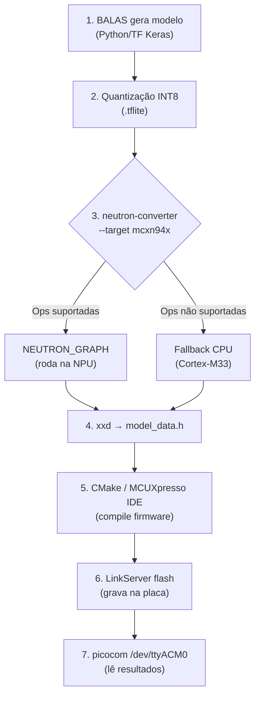

# Tutorial Completo: Usando a NPU do NXP MCXN947 (FRDM-MCXN947)

> [!WARNING]
> Revisado em 27/10/2026: a tabela de operadores da seção 2 está incompleta (faltam `SOFTMAX`, `ADD`, `AVERAGE_POOL_2D`), o ResNet-8 usa `AVERAGE_POOL_2D` (não `MAX_POOL_2D`) e a tabela "Dados Oficiais NXP" não tem fonte confirmada. Ver seções 5.6 e 5.7 de `RELATORIO_ALTERACOES_MLPERF_TINY.md`.

**Projeto:** B.A.L.A.S  
**Data:** Outubro de 2026  
**Placa:** FRDM-MCXN947

---

## Índice
1. [O Que É a NPU do MCXN947](#1-o-que-é-a-npu-do-mcxn947)
2. [Quais Modelos do MLPerf Tiny Rodam na NPU](#2-quais-modelos-do-mlperf-tiny-rodam-na-npu)
3. [O Que Você Precisa Instalar](#3-o-que-você-precisa-instalar)
4. [Passo a Passo: Do Modelo ao Hardware](#4-passo-a-passo-do-modelo-ao-hardware)
5. [Compilando e Gravando na Placa](#5-compilando-e-gravando-na-placa)
6. [Troubleshooting e Dicas](#6-troubleshooting-e-dicas)
7. [Exemplo Pronto da NXP (Atalho)](#7-exemplo-pronto-da-nxp-atalho)

---

## 1. O Que É a NPU do MCXN947

A FRDM-MCXN947 possui uma **NPU (Neural Processing Unit)** embarcada chamada **eIQ Neutron N1-16**. Isso é um coprocessador dedicado a redes neurais, diferente da CPU principal.

### Especificações da NPU

| Característica | Valor |
|---|---|
| **Nome** | eIQ Neutron N1-16 |
| **Compute Pipes** | 4 pipes |
| **MACs por pipe** | 4 blocos INT8 MAC |
| **Total MAC blocks** | 16 (4 × 4) |
| **Clock** | Até 150 MHz (sincronizado com o core) |
| **Throughput** | **4.8 GOPS** (150 MHz × 16 MACs × 2 ops/MAC) |
| **Precisão** | INT8 / UINT8 (com acumuladores INT32) |
| **Extras** | Dequantização in-line, engine de pooling, descompressão de pesos, cache local |

### Especificações do MCU

| Característica | Valor |
|---|---|
| **CPU** | Dual Cortex-M33, até 150 MHz |
| **SRAM** | 512 KB on-chip |
| **Flash** | 2 MB |
| **DSP** | PowerQuad coprocessor (acelera funções DSP) |
| **Debug** | MCU-Link onboard (CMSIS-DAP) |

### O que a NPU NÃO faz

> [!IMPORTANT]
> A NPU **não roda qualquer modelo**. Ela só aceita operadores específicos e modelos **estritamente quantizados em INT8**.

---

## 2. Quais Modelos do MLPerf Tiny Rodam na NPU

### Operadores Suportados pela NPU (Neutron N1-16)

A NPU suporta **nativamente** apenas estes operadores TFLite:

| Operador | Suportado | Notas |
|---|:---:|---|
| `CONV_2D` | ✅ | Per-channel quantization |
| `DEPTHWISE_CONV_2D` | ✅ | Per-channel quantization |
| `FULLY_CONNECTED` | ✅ | Camadas Dense |
| `MAX_POOL_2D` | ✅ | — |
| `PAD` | ✅ | — |
| `RESHAPE` | ✅ | — |
| `SLICE` | ✅ | — |
| ReLU, ReLU6 | ✅ | Fused nos operadores acima |

> [!NOTE]
> `BatchNormalization` é "folded" (absorvida) nas convoluções durante a quantização, então não aparece como operador separado no `.tflite` final. Isso é normal.

### Compatibilidade dos 4 Benchmarks MLPerf Tiny

| Benchmark | Tipo de Modelo | Operadores Usados | Roda na NPU? | Speedup vs CPU |
|---|---|---|:---:|---|
| **Anomaly Detection** | Deep Autoencoder (Dense) | `FULLY_CONNECTED` | ✅ SIM | ~6.5× |
| **Keyword Spotting** | DS-CNN | `CONV_2D`, `DEPTHWISE_CONV_2D`, `FULLY_CONNECTED` | ✅ SIM | ~15.8× |
| **Visual Wake Words** | MobileNetV1 (α=0.25) | `CONV_2D`, `DEPTHWISE_CONV_2D`, `FULLY_CONNECTED` | ✅ SIM | ~28.2× |
| **Image Classification** | ResNet-8 | `CONV_2D`, `FULLY_CONNECTED`, `MAX_POOL_2D` | ✅ SIM | ~37.4× |

> [!TIP]
> **TODOS os 4 modelos MLPerf Tiny rodam na NPU!** Isso acontece porque todos usam apenas operadores suportados e são quantizados em INT8.

### Performance Benchmarks (Dados Oficiais NXP)

| Modelo | CPU (Cortex-M33) | NPU (Neutron N1-16) | Speedup |
|---|---|---|---|
| Anomaly Detection | ~5.30 ms | ~0.82 ms | 6.5× |
| Keyword Spotting | ~57.51 ms | ~3.65 ms | 15.8× |
| Visual Wake Words | ~184.94 ms | ~6.57 ms | 28.2× |
| Image Classification | ~239.04 ms | ~6.40 ms | 37.4× |

---

## 3. O Que Você Precisa Instalar

### 3.1. Pré-requisitos do Sistema (Linux)

```bash
# Ferramentas de build essenciais
sudo apt update
sudo apt install -y build-essential cmake ninja-build git python3 python3-pip python3-venv wget unzip

# Ferramenta para serial (para ver output da placa)
sudo apt install -y picocom minicom
```

### 3.2. Arm GNU Toolchain (Compilador para ARM)

O compilador que gera binários para o Cortex-M33:

```bash
# Baixar o Arm GNU Toolchain (versão 13.2 ou superior)
wget https://developer.arm.com/-/media/Files/downloads/gnu/13.2.rel1/binrel/arm-gnu-toolchain-13.2.rel1-x86_64-arm-none-eabi.tar.xz

# Extrair em /opt
sudo tar -xf arm-gnu-toolchain-13.2.rel1-x86_64-arm-none-eabi.tar.xz -C /opt/

# Adicionar ao PATH (coloque no seu ~/.bashrc)
echo 'export PATH="/opt/arm-gnu-toolchain-13.2.rel1-x86_64-arm-none-eabi/bin:$PATH"' >> ~/.bashrc
echo 'export ARMGCC_DIR="/opt/arm-gnu-toolchain-13.2.rel1-x86_64-arm-none-eabi"' >> ~/.bashrc
source ~/.bashrc

# Verificar
arm-none-eabi-gcc --version
```

### 3.3. MCUXpresso SDK para FRDM-MCXN947

O SDK da NXP contém drivers, middleware (incluindo TFLite Micro) e exemplos:

1. Acesse: **https://mcuxpresso.nxp.com/**
2. Selecione a placa **FRDM-MCXN947**
3. Na tela de configuração do SDK, marque:
   - ✅ **eIQ** → **TensorFlow Lite for Microcontrollers**
   - ✅ **eIQ** → **Neutron NPU** (se disponível como componente separado)
4. Faça o download e extraia:

```bash
mkdir -p ~/mcuxpresso/sdk
unzip SDK_FRDM-MCXN947.zip -d ~/mcuxpresso/sdk/frdmmcxn947
```

### 3.4. eIQ Neutron SDK (O Compilador da NPU)

Esta é a ferramenta que **converte** seu modelo `.tflite` para rodar na NPU. Sem ela, o modelo roda só na CPU.

```bash
# Criar um venv dedicado (recomendado)
python3 -m venv ~/neutron-env
source ~/neutron-env/bin/activate

# Instalar o SDK da NPU a partir do repositório NXP
pip install eiq-neutron-sdk --index-url https://eiq.nxp.com/repository/ --extra-index-url https://pypi.org/simple

# Verificar que a ferramenta está disponível
neutron-converter --help
# OU (dependendo da versão)
python -m eiq_neutron_sdk --help
```

> [!WARNING]
> Se `pip install eiq-neutron-sdk` não funcionar diretamente, pode ser necessário configurar o pip globalmente:
> ```bash
> python -m pip config --user set global.index-url https://eiq.nxp.com/repository/
> python -m pip config --user set global.trusted-host eiq.nxp.com
> python -m pip config --user set global.extra-index-url https://pypi.org/simple
> ```
> Depois tente novamente: `pip install eiq-neutron-sdk`

### 3.5. Ferramenta de Gravação: NXP LinkServer

O **LinkServer** é a ferramenta oficial da NXP para gravar binários na placa via USB.

1. Baixe o LinkServer de: **https://www.nxp.com/design/design-center/software/development-software/mcuxpresso-software-and-tools-/linkserver-for-microcontrollers:LINKERSERVER**
2. Instale o pacote `.deb`:

```bash
sudo dpkg -i LinkServer_*.deb
# Se faltar dependências:
sudo apt --fix-broken install
```

O LinkServer se instala normalmente em `/usr/local/LinkServer/`.

### 3.6. Permissões USB (udev)

Para acessar a placa sem `sudo`:

```bash
# Criar regra udev para o MCU-Link onboard
sudo tee /etc/udev/rules.d/99-nxp-mcu-link.rules << 'EOF'
SUBSYSTEM=="usb", ATTRS{idVendor}=="1fc9", ATTRS{idProduct}=="01df", MODE="0666"
EOF

sudo udevadm control --reload-rules && sudo udevadm trigger
```

---

## 4. Passo a Passo: Do Modelo ao Hardware

O workflow completo tem **5 etapas**:

```
┌─────────────┐    ┌──────────────┐    ┌──────────────┐    ┌───────────┐    ┌───────────┐
│ 1. Modelo   │───▶│ 2. Quantizar │───▶│ 3. Converter │───▶│ 4. Embutir│───▶│ 5. Gravar │
│ TF/Keras    │    │ para INT8    │    │ para NPU     │    │ no código │    │ na placa  │
│ (.h5)       │    │ (.tflite)    │    │ (.tflite)    │    │ (.h/.s)   │    │ (.elf)    │
└─────────────┘    └──────────────┘    └──────────────┘    └───────────┘    └───────────┘
```

### 4.1. Etapa 1 + 2: Gerar o Modelo Quantizado (INT8 .tflite)

> [!NOTE]
> **O BALAS já faz isso!** Os builders (`anomaly_detection.py`, `keyword_spotting.py`, etc.) já produzem `.tflite` quantizados em INT8. Se você rodou o pipeline de DSE, os modelos já estão prontos em `artifacts/`.

Se quiser verificar que o modelo é INT8:
```bash
# Usando Python + TFLite
python3 -c "
import tensorflow as tf
interp = tf.lite.Interpreter(model_path='seu_modelo.tflite')
interp.allocate_tensors()
for t in interp.get_input_details():
    print(f'Input: {t[\"name\"]} dtype={t[\"dtype\"]} shape={t[\"shape\"]}')
for t in interp.get_output_details():
    print(f'Output: {t[\"name\"]} dtype={t[\"dtype\"]} shape={t[\"shape\"]}')
"
# O dtype deve ser <class 'numpy.int8'>
```

### 4.2. Etapa 3: Converter o Modelo para a NPU (neutron-converter)

Esta é a **etapa crucial** que o BALAS ainda não faz automaticamente. O `neutron-converter` analisa o modelo e:
- Agrupa os operadores suportados em um mega-operador chamado `NEUTRON_GRAPH`
- Compila instruções de máquina específicas para o hardware Neutron N1-16
- Operadores não suportados são deixados para fallback no Cortex-M33

```bash
# Ativar o venv do Neutron SDK
source ~/neutron-env/bin/activate

# Converter o modelo
neutron-converter \
    --input seu_modelo_quant_int8.tflite \
    --output seu_modelo_npu.tflite \
    --target mcxn94x

# O output vai te dizer:
# - Quantos operadores foram mapeados para a NPU
# - Quantos ficaram em fallback (CPU)
# - Estimativa de memória necessária (tensor arena)
```

> [!IMPORTANT]
> **O flag `--target mcxn94x` é obrigatório.** Ele diz ao compilador para gerar código para o Neutron N1-16 específico do MCXN947. Sem esse flag, não vai funcionar.

### 4.3. Etapa 4: Embutir o Modelo no Projeto C/C++

O modelo convertido precisa ser transformado num array de bytes C para ser incluído no firmware:

```bash
# Converter .tflite para header C usando xxd
xxd -c 16 -i seu_modelo_npu.tflite > model_data.h
```

Isso gera algo como:
```c
unsigned char seu_modelo_npu_tflite[] = {
  0x20, 0x00, 0x00, 0x00, 0x54, 0x46, 0x4c, 0x33, ...
};
unsigned int seu_modelo_npu_tflite_len = 123456;
```

### 4.4. Etapa 5: Integrar no Código da Aplicação

No código C++ do firmware, a integração com a NPU é **transparente** — você usa o mesmo runtime TFLite Micro, mas registra o operador customizado da NPU:

```cpp
#include "tensorflow/lite/micro/micro_mutable_op_resolver.h"
#include "tensorflow/lite/micro/micro_interpreter.h"

// O modelo convertido para NPU
#include "model_data.h"

// Registrar o operador da NPU (NEUTRON_GRAPH)
extern const TFLMRegistration* Register_NEUTRON_GRAPH();

// Tensor arena - buffer de trabalho na SRAM
// ATENÇÃO: ajuste o tamanho conforme o modelo!
constexpr int kTensorArenaSize = 256 * 1024;  // 256 KB
alignas(16) static uint8_t tensor_arena[kTensorArenaSize];

void run_inference() {
    const tflite::Model* model = tflite::GetModel(seu_modelo_npu_tflite);

    // Registrar operadores: os da CPU + o NEUTRON_GRAPH
    static tflite::MicroMutableOpResolver<6> resolver;
    resolver.AddConv2D();           // fallback CPU, se necessário
    resolver.AddDepthwiseConv2D();  // fallback CPU, se necessário
    resolver.AddFullyConnected();   // fallback CPU, se necessário
    resolver.AddReshape();
    resolver.AddSoftmax();
    // ** O OPERADOR DA NPU **
    resolver.AddCustom("NEUTRON_GRAPH", Register_NEUTRON_GRAPH());

    // Criar interpretador
    tflite::MicroInterpreter interpreter(model, resolver,
                                          tensor_arena, kTensorArenaSize);
    interpreter.AllocateTensors();

    // Preencher input
    TfLiteTensor* input = interpreter.input(0);
    // ... copiar dados de entrada para input->data.int8 ...

    // Rodar inferência (NPU é usada automaticamente!)
    interpreter.Invoke();

    // Ler output
    TfLiteTensor* output = interpreter.output(0);
    // ... interpretar resultado ...

    // Opcional: medir tensor arena usado
    size_t used = interpreter.arena_used_bytes();
    printf("Tensor arena usado: %zu bytes\n", used);
}
```

> [!TIP]
> A mágica está no `Register_NEUTRON_GRAPH()`. Quando o interpretador encontra um nó `NEUTRON_GRAPH` no modelo convertido, ele automaticamente despacha a computação para o hardware da NPU. Você não precisa chamar nenhuma API da NPU diretamente.

---

## 5. Compilando e Gravando na Placa

### 5.1. Opção A: Usando MCUXpresso IDE (GUI)

1. Abra o **MCUXpresso IDE**
2. Importe o projeto de exemplo eIQ da SDK (ex: `tensorflow_lite_micro_cifar10`)
3. Substitua o model data pelo seu `model_data.h`
4. Compile (Build)
5. Conecte a FRDM-MCXN947 via USB
6. Debug / Flash

### 5.2. Opção B: Linha de Comando (CMake + Make)

```bash
# Navegar até o exemplo
cd ~/mcuxpresso/sdk/frdmmcxn947/examples/frdmmcxn947/eiq_examples/tensorflow_lite_micro_cifar10/armgcc

# Compilar (o script já configura tudo)
chmod +x build_release.sh
./build_release.sh

# OU manualmente com CMake:
mkdir -p build && cd build
cmake -DCMAKE_TOOLCHAIN_FILE=../../../../../core/tools/cmake_toolchain/armgcc.cmake \
      -DCMAKE_BUILD_TYPE=Release ..
make -j$(nproc)
```

### 5.3. Opção C: BALAS compile.sh (já existe!)

O projeto BALAS já tem um [compile.sh](file:///home/cami/Documentos/balas/compile.sh) configurado para NXP. Ele usa o MCUXpresso IDE em modo headless:

```bash
# Compilar para NXP (o padrão)
BALAS_TARGET=nxp ./compile.sh
```

### 5.4. Gravar o Firmware na Placa

#### Com LinkServer (recomendado):
```bash
# Conecte a FRDM-MCXN947 via USB Debug
# Verificar que a placa foi detectada
/usr/local/LinkServer/LinkServer probes

# Gravar o binário
/usr/local/LinkServer/LinkServer flash --probe '#1' \
    -o /device/memory/1/flash-driver=MCXN9xx_S.cfx \
    -o /device/memory/1/location=0x10000000 \
    build/release/seu_projeto.bin
```

#### Com pyOCD (alternativa):
```bash
pip install pyocd
pyocd pack --update

# Gravar
pyocd flash -t mcxn947 build/release/seu_projeto.bin
```

### 5.5. Ver o Output Serial

```bash
# Encontrar a porta serial
ls /dev/ttyACM*

# Conectar (115200 baud, padrão da NXP)
picocom -b 115200 /dev/ttyACM0
# OU
minicom -D /dev/ttyACM0 -b 115200
```

---

## 6. Troubleshooting e Dicas

### 6.1. Memória: Tensor Arena

> [!CAUTION]
> O MCXN947 tem apenas **512 KB de SRAM**. Se o modelo for grande demais, a tensor arena não vai caber.

**Estratégia de sizing:**
1. Comece com `kTensorArenaSize = 256 * 1024` (256 KB)
2. Rode na placa e meça com `interpreter.arena_used_bytes()`
3. Ajuste para o valor medido + 10-15% de margem
4. Se não couber, reduza o modelo (via BALAS DSE: alpha menor, menos blocos, etc.)

### 6.2. Modelo Não Cabe na Flash

A Flash é de 2 MB. Se o `.tflite` compilado for grande demais:
- Verifique o tamanho: `ls -la seu_modelo_npu.tflite`
- Os modelos MLPerf Tiny são todos < 500 KB, então não deve ser problema

### 6.3. NPU Não Acelera (Fallback Total para CPU)

Se o speedup for 1× (sem aceleração):
- Verifique que usou `neutron-converter --target mcxn94x`
- Verifique que registrou `NEUTRON_GRAPH` no resolver
- Verifique que o modelo está em INT8 (não float32!)

### 6.4. Região de Memória Não-Cacheável

A NPU pode precisar de buffers em região não-cacheável. Se der crash:
- Modifique o **linker script** para criar uma seção `NCACHE_REGION`
- Coloque a tensor arena nessa região:
```cpp
__attribute__((section(".ncache")))
alignas(16) static uint8_t tensor_arena[kTensorArenaSize];
```

### 6.5. LinkServer não encontra a placa

```bash
# Verificar USB
lsusb | grep -i nxp

# Se não aparecer, verifique:
# 1. Cabo USB (use o da porta Debug, não o da porta de alimentação)
# 2. Regras udev (seção 3.6)
# 3. Reinicie o udev: sudo udevadm control --reload-rules
```

---

## 7. Exemplo Pronto da NXP (Atalho)

A NXP já tem um **projeto pronto** que roda exatamente os 4 benchmarks MLPerf Tiny comparando CPU vs NPU:

### Projeto: `dm-mcxn947-npu-vs-tensorflm-benchmark`

Disponível no **NXP Application Code Hub**:

1. Abra o **MCUXpresso IDE** ou **MCUXpresso for VS Code**
2. Vá em **Quick Start Panel** → **Import from Application Code Hub**
3. Busque: `MCXN947 NPU vs Tensorflm Benchmark`
4. Importe, compile e rode na placa

> [!NOTE]
> Esse projeto da NXP opcionalmente usa um LCD TFT (Mikroe TFT PROTO 5") para mostrar os resultados graficamente. Sem o LCD, os resultados saem pela UART serial.

---

## Resumo Visual do Workflow



---

## Checklist Final

- [ ] Arm GNU Toolchain instalado (`arm-none-eabi-gcc --version`)
- [ ] MCUXpresso SDK baixado com componente eIQ/TFLite Micro
- [ ] eIQ Neutron SDK instalado (`neutron-converter --help`)
- [ ] LinkServer instalado (`/usr/local/LinkServer/LinkServer --version`)
- [ ] Regras udev configuradas para USB
- [ ] Modelo `.tflite` INT8 gerado pelo BALAS
- [ ] Modelo convertido para NPU com `neutron-converter --target mcxn94x`
- [ ] Header `model_data.h` gerado com `xxd`
- [ ] Projeto C++ compilado com `Register_NEUTRON_GRAPH()` registrado
- [ ] Firmware gravado na placa
- [ ] Serial conectada para ver resultados
